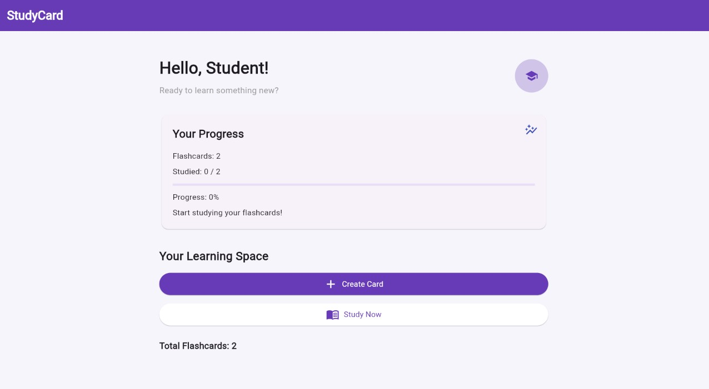
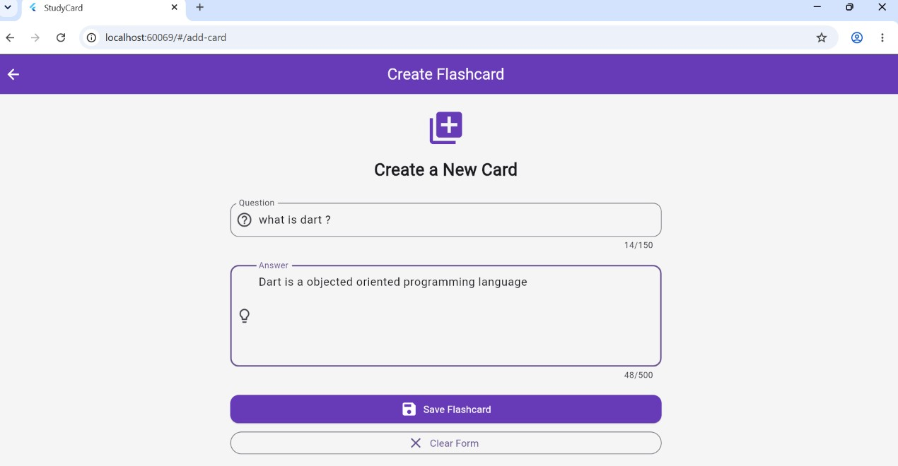
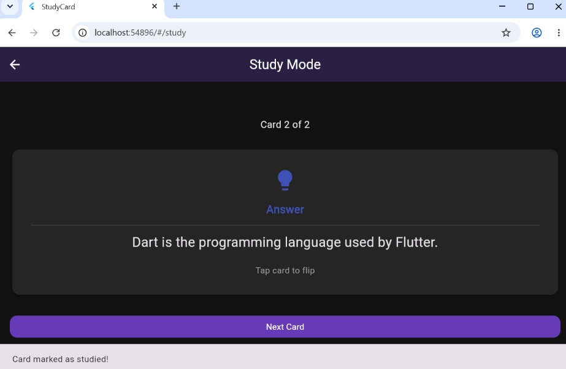
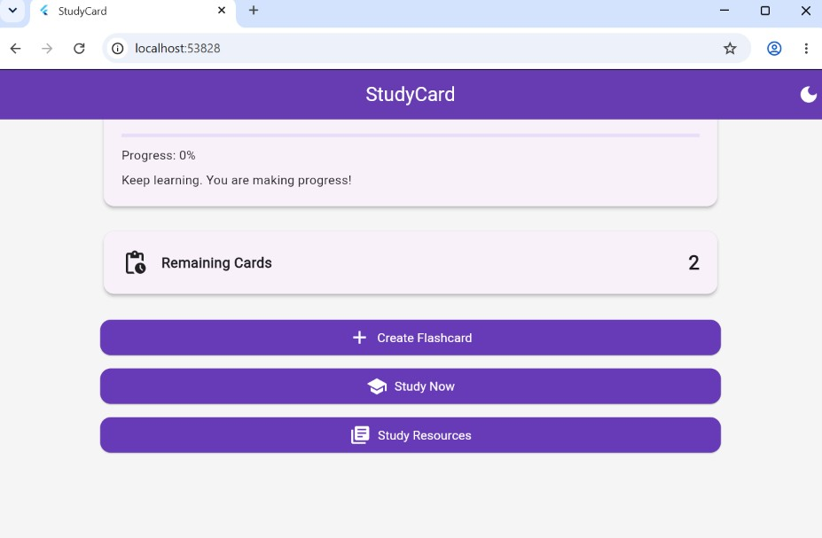
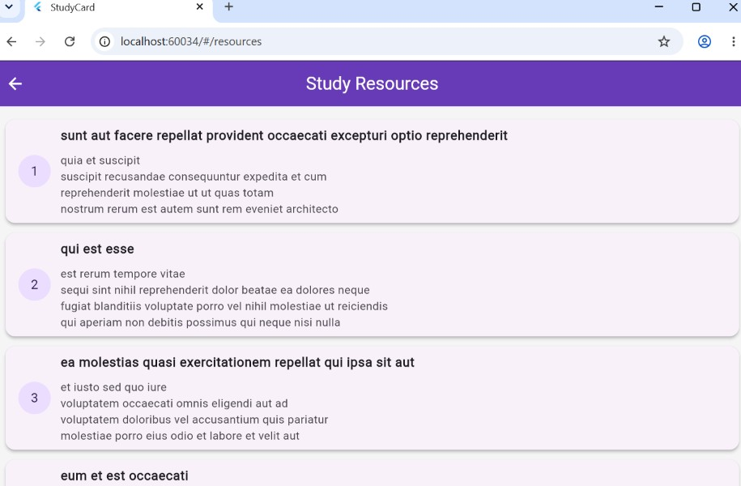
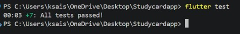

# Study Card App – Flutter

## Project Overview

The **Study Card App** is a Flutter-based application that helps students create, organize, and study flashcards. It provides a simple interface for adding questions and answers, tracking study progress, and accessing learning resources through a REST API.

## Technologies Used

- Flutter
- Dart
- Provider – State Management
- REST API
- JSON
- HTTP package
- Visual Studio Code
- Chrome

## Project Structure

```text
Studycardapp/
├── lib/
│   ├── models/
│   │   ├── flashcard.dart
│   │   └── study_resource.dart
│   ├── providers/
│   │   └── flashcard_provider.dart
│   ├── utils/
│   │   ├── flashcard_utils.dart
│   │   ├── app_theme.dart
│   │   └── api_service.dart
│   ├── widgets/
│   │   └── progress_card.dart
│   ├── add_card_page.dart
│   ├── main.dart
│   ├── study_page.dart
│   └── resources_page.dart
├── test/
│   ├── flashcard_provider_test.dart
│   ├── widget_test.dart
│   └── widget_interaction_test.dart
├── pubspec.yaml
└── README.md
```

---

# EXPERIMENT 1: Flutter Setup, Dart Utilities and Data Model

### Aim

To set up a Flutter application and understand Dart programming concepts by creating utility functions and data models.

### Concepts Implemented

- Flutter project creation and configuration.
- Dart classes and objects.
- Flashcard data model.
- Dart utility functions.
- Constructors and object-oriented programming.

### Implementation

Created the initial Flutter project and defined a Flashcard model containing question and answer fields. Utility functions were implemented to support flashcard operations.

### Screenshots

_Add your Experiment 1 screenshots here._



---

# EXPERIMENT 2: Home Screen UI and Flutter Layout Widgets

### Aim

To design the Study Card application home screen using Flutter widgets and layout structures.

### Concepts Implemented

- Material Design widgets.
- Row and Column.
- Container and Card.
- Text and buttons.
- Layout management.
- Visual elements and UI organization.

### Implementation

Designed the home dashboard with options to create flashcards, start studying, and access study resources. Used reusable Flutter widgets to organize the interface.

### Screenshots

_Add your Experiment 2 screenshots here._


---

# EXPERIMENT 3: Responsive and Adaptive UI Design

### Aim

To implement responsive and adaptive layouts that work across different screen sizes.

### Concepts Implemented

- Responsive dashboard.
- MediaQuery.
- Adaptive screen configurations.
- Dynamic layout adjustments.
- Flexible UI components.

### Implementation

Improved the dashboard layout to adjust to different screen dimensions and provide a consistent user experience.

### Screenshots

_Add your Experiment 3 screenshots here._


---

# EXPERIMENT 4: Navigation and Named Routes

### Aim

To implement navigation between different screens using Flutter navigation techniques.

### Concepts Implemented

- Navigator.
- Navigator.push and Navigator.pop.
- Named routes.
- Route configuration.
- Screen transitions.

### Implementation

Created separate screens for the home dashboard, flashcard creation, study mode, and study resources. Configured named routes for navigation between screens.

### Screenshots

_Add your Experiment 4 screenshots here._


---

# EXPERIMENT 5: State Management Using Provider

### Aim

To manage application state using the Provider package and ChangeNotifier.

### Concepts Implemented

- Provider package.
- ChangeNotifier.
- ChangeNotifierProvider.
- Consumer and context.watch.
- Shared application state.
- Progress tracking.

### Implementation

Implemented FlashcardProvider to manage flashcard data. The provider supports adding cards, marking cards as studied, and tracking total, completed, and remaining cards.

### Screenshots

_Add your Experiment 5 screenshots here._


---

# EXPERIMENT 6: Reusable Widgets and Application Themes

### Aim

To create reusable widgets and implement centralized application styling with light and dark themes.

### Concepts Implemented

- Custom reusable widgets.
- Widget composition.
- ThemeData.
- Centralized styling.
- Light theme.
- Dark theme.
- Theme switching.

### Implementation

Created a reusable progress card widget and centralized application styling. Implemented light and dark modes with a theme toggle.

### Screenshots

_Add your Experiment 6 screenshots here._



---

# EXPERIMENT 7: Flashcard Creation, Form Validation and Error Handling

### Aim

To implement form-based flashcard creation with validation and user feedback.

### Concepts Implemented

- TextFormField.
- TextEditingController.
- Form and GlobalKey.
- Form validation.
- Error handling.
- SnackBar notifications.
- User feedback.

### Implementation

Created a form to accept flashcard questions and answers. Added validation to prevent empty submissions and provided feedback to users after operations.

### Screenshots

_Add your Experiment 7 screenshots here._



---

# EXPERIMENT 8: Explicit and Implicit Animations

### Aim

To implement animations in Flutter using explicit and implicit animation techniques.

### Concepts Implemented

- AnimationController.
- Tween.
- SingleTickerProviderStateMixin.
- ScaleTransition.
- AnimatedContainer.
- AnimatedOpacity.

### Implementation

Added animations to the flashcard study interface. Explicit animations were implemented using AnimationController and ScaleTransition, while implicit animations were implemented using AnimatedContainer and AnimatedOpacity.

### Screenshots

_Add your Experiment 8 screenshots here._



---

# EXPERIMENT 9: REST API Integration, JSON Parsing and ListView

### Aim

To fetch data from a REST API, parse JSON responses, and display the retrieved information using Flutter ListView widgets.

### Concepts Implemented

- REST API integration.
- HTTP GET request.
- JSON decoding.
- Model-based JSON parsing.
- Future and asynchronous programming.
- FutureBuilder.
- ListView.builder.
- Loading and error states.

### Implementation

Integrated the JSONPlaceholder REST API to retrieve study resource data. Parsed the JSON response into StudyResource objects and displayed the records using ListView.builder.

**API Used:** https://jsonplaceholder.typicode.com/posts

### Screenshots

_Add your Experiment 9 screenshots here._



---

# EXPERIMENT 10: Unit Testing, Widget Testing and Debugging

### Aim

To test application functionality using Flutter testing tools and perform final debugging.

### Concepts Implemented

- Unit testing.
- Widget testing.
- Widget interaction testing.
- Test cases and assertions.
- Flutter debugging.
- Application verification.

### Implementation

Created unit tests for flashcard provider operations, including adding cards, marking cards as studied, and progress calculation.

Created widget tests to verify application loading, flashcard form navigation, and text input functionality.

### Test Results

- Unit and widget tests: **9 tests passed**
- Flutter analysis: No errors reported; 5 informational suggestions.
- Manual application testing: Completed.

### Screenshots

_Add your Experiment 10 screenshots here._



---

## How to Run the Project

### Prerequisites

- Flutter SDK
- Dart SDK
- Visual Studio Code or Android Studio
- Chrome browser

### Installation

Clone the repository:

```bash
git clone https://github.com/snehitha-coder/Study-Card-app.git
```

Navigate to the project directory:

```bash
cd Study-Card-app
```

Install dependencies:

```bash
flutter pub get
```

Run the application:

```bash
flutter run -d chrome
```

Run tests:

```bash
flutter test
```

Build the web application:

```bash
flutter build web
```

## Application Features

1. Create and manage flashcards.
2. Study questions and answers.
3. Track study progress.
4. Responsive dashboard.
5. Light and dark themes.
6. Form validation and error handling.
7. Animated user interface.
8. REST API integration.
9. JSON data parsing.
10. Study resources displayed using ListView.

## Conclusion

The Study Card App demonstrates the practical implementation of Flutter and Dart concepts through ten experiments. It covers UI development, responsive layouts, navigation, state management, themes, animations, REST API integration, JSON parsing, and software testing.

## GitHub Repository

[Study Card App – GitHub](https://github.com/snehitha-coder/Study-Card-app)
